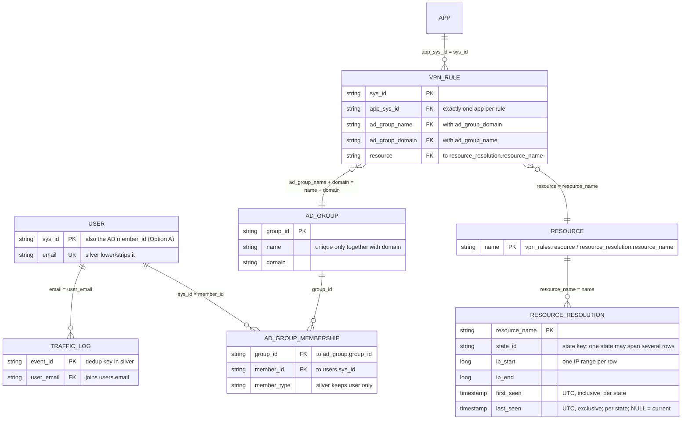
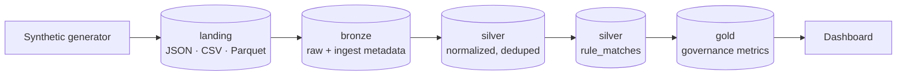

# Architecture

> Living document — sections marked **TBD** are filled in as the pipeline is built.
> All data in this project is synthetic.

## 1. Context

Enterprise VPN / Zero-Trust access platforms grant access through **rules**. Over time rules pile
up: some are never used, some duplicate each other, and many grant far more access than anyone
actually uses. Every rule adds load on the access platform and risk to the organization.

This project is a batch pipeline that answers, per rule: **is it used, is it duplicated, and how
much of the access it grants is actually exercised?** It does so by matching connection logs
against rules, on synthetic data at 100M+ events, with PySpark and Delta Lake.

## 2. Functional overview

Governance metrics produced per rule, over a time window:

| # | Metric | Question it answers |
|---|---|---|
| 1 | Unused rules | Did any connection match this rule? |
| 2 | Duplicate rules | Does another app/gateway have a rule granting the same IP(s), ports, protocol and group? |
| 3 | User over-provisioning | Active users granted (active users in group) vs distinct active users actually connecting |
| 4 | Port over-provisioning | Ports granted (range width) vs distinct ports actually used |
| 5 | IP over-provisioning | IPs granted (e.g. subnet size) vs distinct IPs actually hit |
| 6 | Unstable resources | Does the rule's resource resolve to changing IP sets (more than *N* distinct resolution states in a rolling *D*-day window, configurable)? |

Results feed a dashboard (Databricks AI/BI).

## 3. Domain model

| Entity | Scale (synthetic) | Landing format | Notes |
|---|---|---|---|
| `users` | ~100k | JSON Lines | Some disabled. `sys_id` doubles as the AD `member_id` (see join path). |
| `apps` | ~1–2k | JSON Lines | Independent rule namespaces (department/project) |
| `vpn_rules` | ~120k | JSON Lines | App + gateway + resource + port spec (`"443"` or `"1-99"`) + protocol + group. Group is referenced by **name + domain**, not by id. |
| `ad_group` | ~500k | CSV | Group id, name, domain. `name` is only unique within `domain`. |
| `ad_group_membership` | ~20M | CSV | One row per membership; already flattened upstream (no nested groups); `member_type` distinguishes `user` from other members. |
| `resource_resolutions` | ~1–2M (12 months of history) | Parquet | One **state** = `(resource_name, state_id, first_seen, last_seen)`; a state may hold several IP ranges, one per row (`ip_start`/`ip_end` as **64-bit integers**; single IP ⇒ start = end, subnet ⇒ first/last). Timestamps are UTC and half-open. |
| `traffic_logs` | **100M+** | CSV, daily batches | One event per connection: user email, destination IP, port, protocol, ALLOW/DENY. ~12 months |

### Code fields

Only one integer code affects the analysis:

| Field | Code | Meaning | Used by |
|---|---|---|---|
| `vpn_rules.operational_status` | `1` | OPERATIONAL — the only active code | silver keeps these rules only |
| | `0`, `3` | NON-OPERATIONAL, SUSPENDED | excluded from all analysis |
| `users.status` | `1` | ACTIVE — the only active code | silver keeps these users only |
| | `0`–`6` except `1` | inactive | excluded from all analysis |

These are the codes the generator emits; the pipeline checks only `== 1` and treats **any** other
value as inactive. `OPERATIONAL_STATUS_ACTIVE` and `USER_STATUS_ACTIVE` in `config.py` are the
single sources of truth for the two fields, and each schema column carries the same note in its
metadata comment. `DISABLED_USER_RATIO` controls how many users get inactive codes.

An upstream `resource_type` code was deliberately left out: it is unreliable and no join or metric
uses it.

Key property of the problem: **logs don't say which rule allowed them.** A connection can be
covered by several rules (different groups, or another app's rule on a large group), so every
rule that *could* have allowed it counts as used.

**Upstream (out of scope):** the API sync service for users/apps/rules (full daily snapshots),
the resource resolution service, and nested-group expansion. The pipeline starts from their
exports in landing. See `docs/later.md`.

### Matching join path

These are the exact conditions the silver matching transform will implement. Each step is also a
row in `JOIN_KEYS` in `tests/test_schemas.py`, so a renamed or retyped column fails fast.

1. `traffic_logs.user_email` → `users.email` (silver lower/strips both) → take `users.sys_id`.
   **Decision (Option A):** the API `sys_id` is the same identifier as the AD export's
   `member_id`. No separate `ad_object_id` column exists; if the real export ever disagrees,
   this is the decision to revisit.
2. `users.sys_id` → `ad_group_membership.member_id`; keep `member_type = 'user'` and dedupe
   `(group_id, member_id)`.
3. `ad_group_membership.group_id` → `ad_group.group_id`. This hop is needed because rules name
   groups rather than carrying their id.
4. `vpn_rules.(ad_group_name, ad_group_domain)` → `ad_group.(name, domain)`. Composite: group
   names are only unique within a domain.
5. `vpn_rules.resource` → `resource_resolution.resource_name`, restricted to the state whose
   interval contains the event: `first_seen <= event_time AND (last_seen IS NULL OR event_time < last_seen)`.
   Intervals are **half-open** and disjoint **between states** (rows of one state share their
   timestamps); a `NULL` `last_seen` means the state is current. Each event matches exactly one
   state, but any range in that state may satisfy the IP predicate — so `rule_matches` is deduped
   on `(event_id, rule_sys_id)`.
6. `vpn_rules.app_sys_id` → `apps.sys_id`. Exactly one app per rule.

A rule counts as used when an ALLOW event satisfies steps 1–5 plus the IP range, port range and
protocol predicates. The *direction* of a join (which side is built/probed) is a performance
decision; the conditions above are not.

`ad_group_membership.group_domain` duplicates `ad_group.domain` by design because the upstream
CSV is flat. Never join on it — go through `ad_group.group_id`.

## 4. Pipeline (medallion)

- **Landing:** upstream exports in their natural formats — JSON Lines (users, apps, rules; one
  object per line, no page envelope), CSV (AD groups, memberships, traffic logs), Parquet
  (resolutions). Logs: one folder per day, continuing `LATE_EVENT_MAX_DAYS` past `END_DATE` so
  late events near year-end still land. Generated event times carry an explicit `Z` and Parquet
  timestamps are UTC-aware, so parsing does not depend on `spark.sql.session.timeZone`.
  Generated locally (`python -m netusage.generator`) or on Databricks straight into the landing
  Volume (`notebooks/05_generate_landing.py`). Randomness is hash-based, so both produce the same
  rows: on SMALL, `validation.py` reports identical counts in both environments.
- **Bronze:** Delta tables (`netusage.bronze.<entity>`), landing columns plus `_corrupt_record`
  (CSV/JSON Lines), `source_file`, `batch_date`, `ingest_ts`. Not partitioned (small daily
  slices; Delta's per-file min/max stats skip files instead — compared in the optimization
  notes). **Re-runs replace, never append:** each write is a Delta `replaceWhere` over its slice,
  one atomic commit. Traffic logs: `batch_date` comes from the landing folder, and a run replaces
  `start <= batch_date <= end` in one read and one write (daily run: `start = end`). Snapshot
  entities: the current landing snapshot, stamped `batch_date = end` and replacing that date, so
  bronze keeps one snapshot per run date and a backfill loads them once; silver takes the latest.
  `bronze.ingest_audit` holds rows and `_corrupt_record` counts per entity and batch, counted from
  the bronze tables after the write (writing parses every column, so CSV column pruning can't hide
  malformed rows there) and replaced by the same slice. Code: `netusage.jobs.bronze`, called by
  `notebooks/10_bronze_ingest.py` or locally `python -m netusage.jobs.bronze --start … --end …`.
  Explicit schemas; malformed records captured, not dropped silently. `nullable=False` in a landing schema is
  documentary only — file sources mark every column nullable, so required-value checks live in
  silver or in Delta constraints. All readers attach `source_file` from `_metadata.file_path`
  (CSV, JSON Lines and Parquet); unlike `input_file_name()`, it works on serverless compute and
  survives a cache. CSV reads use `enforceSchema=False`, which validates the header against the
  schema and fails on a mismatch — the default positional matching would silently shift a
  reordered export into the wrong columns. CSV and JSON Lines readers add `_corrupt_record`:
  rows with a wrong field count, malformed JSON, or a field with the wrong type keep their raw
  text there. Parquet is schema-enforced, so it has no corrupt rows by design. Spark disallows
  querying a raw file when only the corrupt column is needed; `corrupt_rows()` only filters, so
  the caller caches locally for that workaround (serverless has no `cache()`). In production,
  write the parsed DataFrame to bronze Delta and query corrupt rows there — Delta has no such
  restriction.
  **On Databricks** (SMALL, first run): the backfill's audit totals equal the local run and
  `validation.py` for every entity (e.g. traffic 1,004,969 rows / 476 corrupt). A one-day re-run
  leaves the totals unchanged. Unity Catalog managed tables enable **deletion vectors**, so that
  re-run marked the day's 2,823 old rows deleted in place and added one ~50 KB file, with no file
  removed. Locally, without deletion vectors, it rewrites the whole multi-day file holding the
  day. `operationMetrics` reports the logical rewrite (`numCopiedRows`) in both cases; check
  `DESCRIBE DETAIL` (file count, size) for what was physically written. Deleted rows are still
  scanned until `OPTIMIZE` purges them.
- **Silver:** pure transforms in `netusage.transforms.silver`, one per table. Snapshot tables
  first keep the newest bronze snapshot (`latest_snapshot`: a semi-join against the broadcast
  1-row max of `batch_date`, so the plan stays lazy and no `Window` without `partitionBy`).

  | Table (transform) | Inputs | One row per | Business filter | Flags added |
  |---|---|---|---|---|
  | `users` | bronze `users` | user | `status = USER_STATUS_ACTIVE` | `is_corrupt` |
  | `apps` | bronze `apps` | app | – | `is_corrupt` |
  | `ad_groups` | bronze `ad_group` | group | – | `is_corrupt` |
  | `vpn_rules` | bronze `vpn_rules` | rule | `operational_status = OPERATIONAL_STATUS_ACTIVE` | `port_spec_valid`, `is_corrupt` |
  | `group_members` | bronze `ad_group_membership`, silver `ad_groups`, all users | `(group_id, member_id)` | `member_type = MEMBER_TYPE_USER` | `is_corrupt`, `is_orphan` |
  | `resolution_states` | bronze `resource_resolution` | (resource, state, IP range) | – | `ip_range_valid`, `period_valid` |
  | `rule_access` | silver `vpn_rules`, silver `resolution_states` | (rule, state, IP range) | – | `has_resolution`; carries `port_spec_valid`, `ip_range_valid`, `period_valid`, `is_corrupt` |
  | `traffic_events` | bronze `traffic_logs` slice, all users | event (`event_id`) | `action = ACTION_ALLOW` | `is_corrupt`, `is_unknown_user` |

  Conventions shared by every table:
  - **Parsed value under the plain name, bronze value as `<name>_raw`** (`user_email` /
    `user_email_raw`, `port_raw`, `protocol_raw`, …): the obvious column is the safe join key.
    Join keys are normalized on both sides with the same function (`normalize_email`,
    `normalize_protocol`); group `name`/`domain` are not normalized (exact upstream values).
  - **Business filters keep corrupt rows:** `filter | is_corrupt`. An unparseable row has null
    columns, so `status = 1` or `action = 'ALLOW'` alone would drop it silently.
  - **Flags are strictly boolean** (`coalesce(…, false)`), never null, so `where(~flag)` finds
    every bad row. Nothing is dropped for being invalid; the caller decides.
  - **"All users" for `is_orphan` and `is_unknown_user`:** every user in the latest snapshot,
    any status. A disabled user exists; only matching and gold restrict to active users (silver
    `users`). On TINY data, using active users only would flag 292 orphans instead of 10 and
    588 unknown-user events instead of 55.
  - **Dedup:** `traffic_events` ranks copies of an `event_id` explicitly (clean first, then
    earliest batch, then file), so a re-run keeps the same copy. `group_members` uses
    `dropDuplicates` on `(group_id, member_id, _corrupt_record)`: within one snapshot the
    copies are identical, and the corrupt-record key keeps clean and corrupt copies apart.
  - Metadata columns (`source_file`, `batch_date`, `ingest_ts`) stay last; `rule_access` is
    derived from two tables and carries none.

  `rule_access` multiplies rows on purpose (every state and range of a rule's resource); it is
  the input of the matching join. Lookups (`ad_groups`, all users) are made `distinct()` before
  a left join so they can only flag rows, never multiply them.
  **Not built yet (Session 5):** the silver job writing these tables, `MERGE` on `event_id`
  across batches, partitioning by `event_date`, `pipeline_runs`.
- **Matching:** each log ↔ every rule whose resolved IP range contains the destination IP
  **at the event's instant**, whose port range contains the port, same protocol, and whose group
  contains the user. Resolution validity is instant-granular with UTC half-open intervals
  `[first_seen, last_seen)`; the full predicate is in §3 "Matching join path".
  **TBD:** join strategy (naive range join vs binning) and measurements.
- **Gold:** the six metrics; recomputed only for dates touched by a batch. Metric 3 counts active
  users on both sides of the comparison. Metric 6 buckets resolution-state changes by UTC date
  into windows `[d - UNSTABLE_WINDOW_DAYS + 1, d]`.

**Runs:** a date-range parameter — one day for the daily run, a range for backfill. A
`pipeline_runs` table records processed batches. **TBD:** Databricks Job definition.

## 5. Infrastructure

| Environment | Purpose |
|---|---|
| Local (Linux/WSL2, Java 17, PySpark 4.2, uv) | Development, unit tests, Spark-internals experiments at 5–20M rows with full Spark UI |
| Databricks Free Edition (serverless, Unity Catalog) | Full-scale runs, Delta tables, Jobs, dashboard. Catalog `netusage`: schemas `landing`, `bronze`, `silver`, `gold` |
| GitHub Actions | `ruff` + `pytest` on every push |

## 6. Constraints

- **Serverless compute:** no Spark UI / `sparkContext`; broadcast threshold and AQE settings are
  locked; shuffle partitions configurable. Low-level tuning experiments therefore run locally;
  Databricks work uses join hints, partitioning, Delta file layout and the query profile.
- **Free Edition quotas:** large backfills run in date-range chunks; every stage supports a small
  (1M-event) fast path.
- **Synthetic data only:** realistic shapes and deliberate data-quality issues (late and duplicate
  events, unknown users, malformed CSV rows, unused/duplicate/over-wide rules, unstable resources).

## 7. Design principles

- **Pure transforms:** `DataFrame(s) -> DataFrame`, no I/O; all reads/writes in `io.py`.
- **Thin notebooks:** read → transform → write.
- **Idempotent runs:** re-running a batch changes nothing.
- **Small scale first:** correctness at 1M events before scaling to 100M.

## 8. Testing

- Schema contract tests (`tests/test_schemas.py`): join keys exist with matching types, IP columns
  are `LongType`. No Spark session needed.
- Unit tests per transform with tiny hand-built DataFrames (local SparkSession, `pytest`).
- Generator validation (`src/netusage/validation.py`, run after `netusage.generator`): row
  counts, referential integrity along join-path steps 1–6, dirty-data ratios (binomial
  tolerance); normalized emails stay unique; resolution states per resource are disjoint and
  ordered, rows of one state share their timestamps, and no state has `last_seen <= first_seen`.
  It reads through the landing readers, so it doubles as their end-to-end test. It deliberately
  does not check rule matching; that belongs to the matching transform's tests.
- Generator integration test (`tests/test_generator.py`): TINY profile over 5 days, asserts all
  validation checks pass, one header-first file per batch folder, malformed rows captured, and
  determinism under re-partitioning.
- Known gotcha, pinned by `tests/test_io.py`: with CSV column pruning (on by default), an
  aggregation over raw CSV files does not flag rows with an extra field in `_corrupt_record`.
  Count corrupt rows only after every column is parsed (cache locally, or in bronze).
- Bronze (`tests/test_bronze.py`): metadata transform and audit counts; `replaceWhere` replaces
  only its slice and rejects rows outside it (only once the table exists — the first write does
  not check); corrupt rows counted exactly from Delta with no cache; on TINY data, bronze matches
  landing, a full re-run leaves every table and the audit unchanged, and a daily run replaces only
  its day.
- Silver unit tests (`tests/test_silver.py`): every expression and table transform on tiny
  hand-built DataFrames, including ANSI breakers, corrupt rows with all-null columns, fan-out
  guards and exact column order; plus one test per table on TINY landing data (with bronze
  metadata added in memory) checking counts and that exactly the planted dirty rows are flagged.
- Silver integration (`tests/test_silver_integration.py`): the real bronze job writes Delta
  twice (backfill + daily run, so two snapshots), then every silver table is built in job order.
  Checks: newest snapshot only, every bronze day present, join-key types between silver tables
  (the columns the matching join compares), foreign keys on clean rows, flags wired with all
  users, and a rebuild from the same bronze gives identical tables.
- Pipeline checks: late-event placement. **TBD:** where these live.

## 9. Decisions

Architecture Decision Records live in `docs/decisions/` (added as decisions are implemented).
Until that directory exists, decisions are recorded inline here:

- **Join keys (Option A):** `users.sys_id == ad_group_membership.member_id`. See §3.
- **Group reference in rules:** `vpn_rules.(ad_group_name, ad_group_domain)` → `ad_group.(name, domain)`;
  names are not globally unique. See §3.
- **Landing schemas only in `schemas.py`:** silver schemas belong with their transforms and tests.
- **Resolution validity:** UTC `TimestampType`, half-open `[first_seen, last_seen)`; `NULL`
  `last_seen` means the state is current. Instant granularity lets a resource change IPs twice in
  one day while each event still matches exactly one state. See §3 and §4.
- **Code fields:** `resource_type` dropped as unused and unreliable; only code `1` is active for
  both `operational_status` and `users.status`. See §3 "Code fields".
- **Multi-range resolutions:** a state may hold several IP ranges; `state_id` identifies it,
  disjointness is checked between states, and metric 6 counts states, not rows. See §3 and §4.
- **Metric 3 denominator:** active users on both sides — granted and actually connecting. See §2.
- **Late events:** landing batches extend to `LANDING_END_DATE = END_DATE + LATE_EVENT_MAX_DAYS`.
- **Landing readers:** `io.py` owns strict CSV headers (`enforceSchema=False`), `_corrupt_record`
  for CSV/JSON Lines, and `source_file` from `_metadata.file_path` for all formats; landing schemas
  stay clean. See §4.
- **Bronze re-runs:** Delta `replaceWhere` by `batch_date` slice instead of append; snapshot
  entities stamped with the run's end date; bronze not partitioned; `ingest_audit` table for
  per-batch row and corrupt counts. See §4.
- **Email uniqueness:** validated in the generator after lower/strip; silver dedup/quarantine is a
  fallback if real data can collide. See §8.
- **Flag invalid data, never drop it in a transform:** applies to every layer. Bronze already
  keeps unparseable rows (`_corrupt_record`). Transforms never filter out invalid rows or remove
  the source column: a `DataFrame -> DataFrame` transform keeps every row and the original column
  and adds the parsed columns plus a `<name>_valid` flag (`normalize_ports`: `port_start`,
  `port_end`, `port_spec_valid`); a `Column -> Column` expression returns `null` for invalid input
  (`ip_to_long`). The caller (the job building a silver table) decides what happens to flagged
  rows: drop, quarantine or keep. Business filters (ALLOW only, active users/rules) are not
  validity checks and stay explicit steps in the table-building transform.
- **Silver latest snapshot:** semi-join against the broadcast 1-row `max(batch_date)` instead of
  `collect()` (an action inside a transform) or an unpartitioned `Window` (all rows in one
  partition). Costs a second scan of the snapshot table. See §4.
- **Silver naming:** parsed value under the plain name, bronze value as `<name>_raw`; applies to
  `vpn_rules` too (`port_raw`, `protocol_raw`). See §4.
- **Business filters keep corrupt rows** (`filter | is_corrupt`) in `users`, `vpn_rules`,
  `group_members` and `traffic_events`. See §4.
- **Orphan memberships and unknown users are flagged, not dropped,** against all users of any
  status; "inactive" is a business filter applied later, "unknown" is a data-quality fact.
  See §4.
- **`rule_access` keeps rules without a resolution** (`has_resolution = false`) and carries the
  validity flags uncombined: the matching join decides in one place which rows are usable.
